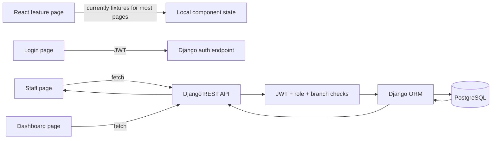

# A to Z business system audit

Date: 2026-10-21

## Scope

This audit covers the current repository before implementation changes. The repository is on `main` with a clean working tree at audit time.

## Current architecture

- Frontend: React 19, TypeScript, Vite, Tailwind CSS, under `frontend_app/`.
- Backend: Django 5.2 and Django REST Framework under `backend/`.
- Database: Django ORM configured for PostgreSQL through `DATABASE_URL`, with a documented SQLite fallback for local smoke tests.
- Authentication: JWT access and refresh tokens with an email based custom user model.
- Domain apps: accounts, branches, customers, services, quotations, jobs, designs, finance, expenses, and audit.
- API routing: `backend/config/urls.py` registers REST endpoints for branches, users, roles, business units, audit logs, customers, services, quotations, jobs, design assignments, invoices, payments, receipts, and expenses.

## What already exists

### Backend

- Customer, quotation, job, invoice, payment, payment allocation, receipt, expense, branch, user, role, permission, approval limit, and audit log models exist.
- Monetary fields use Django `DecimalField`.
- Quotation conversion uses a database transaction.
- Payment creation requires an idempotency key, allocates to an invoice, recalculates invoice balances, and creates a receipt in the same transaction.
- Invoice balances are derived from completed payment allocations through `Invoice.update_balance()`.
- Branch access is represented by user branch assignments and checked through branch-scoped querysets and permissions.
- Role permissions are configurable through role and permission records. The seed command defines a `branch_manager` role and a separate `designer` role; it does not hardcode access to an individual person.
- Important customer, quotation, job, payment, receipt, and expense mutations contain audit logging or dedicated mutation paths.
- Backend tests already include payment idempotency coverage in `backend/apps/core/tests.py`.

### Frontend

- Login calls the JWT endpoint.
- Staff management calls the users endpoint.
- The dashboard calls the CNC dashboard endpoint.
- Application routing and the main layout are present.
- Business feature pages have loading-free visual layouts and client-side filtering patterns that can be reused after API integration.

## Gaps found

### Frontend only or dummy data

The following pages still use hardcoded arrays and do not load or save business records through the API:

- `frontend_app/src/features/customers/CustomersPage.tsx`: `DEMO_CUSTOMERS`; adding a customer only updates React state and assigns an array length as the ID.
- `frontend_app/src/features/quotations/QuotationsPage.tsx`: `DEMO_QUOTES`; the New Quotation button has no persistence path.
- `frontend_app/src/features/jobs/JobsPage.tsx`: `DEMO_JOBS`; status advancement and new job actions are presentation-only.
- `frontend_app/src/features/finance/InvoicesPage.tsx`: `DEMO_INVOICES` and `DEMO_PAYMENTS`; invoice totals and collection figures are computed from fixtures.
- `frontend_app/src/features/expenses/ExpensesPage.tsx`: `DEMO_EXPENSES`; expense totals and actions are presentation-only.
- `frontend_app/src/features/audit/AuditPage.tsx`: `DEMO_AUDIT`; audit history is not loaded from the read-only audit endpoint.
- `frontend_app/src/features/auth/LoginPage.tsx`: demo role quick-fill controls remain in the login UI and must be removed or made clearly development-only before production use.

There is no shared frontend API client or query/cache layer connecting the business pages to the registered REST endpoints. The frontend currently uses scattered direct `fetch` calls.

### Backend and contract risks to verify during implementation

- The frontend types and labels do not consistently match backend names and response shapes, for example branch codes versus branch IDs, quotation status values, and invoice status values.
- Payment recording needs an explicit frontend form for invoice allocation, amount, method, reference, and idempotency key, with server errors preserved in the form.
- Expense creation and approval/payment actions need to be mapped to the existing custom actions and their permission requirements.
- Reports and dashboard figures need backend-derived query results instead of local fixture calculations.
- Branch filtering must use the authenticated user's permitted branch scope; the frontend must not offer unrestricted branch selection as an authorization mechanism.
- Document generation and historical snapshots need to be checked against the existing quotation, job, invoice, and receipt serializers before adding UI actions.
- The current seed command creates system configuration such as branches, roles, and permissions. It must not be treated as a business-data cleanup command.

## Existing data flow

## Target implementation order

1. Add one typed frontend API client and authenticated request/error helpers.
2. Wire customers first, including branch-safe list/search, create, update, empty states, and persisted responses.
3. Wire quotations and jobs using existing serializers and custom actions; remove their fixture arrays.
4. Wire invoices, payments, receipts, and payment idempotency; verify balance updates from persisted allocations.
5. Wire expenses, approval/payment actions, uploads where supported, and report filters.
6. Replace audit, dashboard, and reports fixtures with API responses.
7. Add or update backend and frontend tests for the acceptance workflows, branch isolation, empty database behavior, and duplicate submissions.
8. Run Django checks, migrations in a disposable database, backend tests, frontend type checking, linting, and production build. Record actual command results.

## Data safety decision

No database records were deleted or modified during this audit. The hardcoded frontend fixtures are identified for controlled removal during API integration. The seed command and any database records require separate verification before cleanup.

## Baseline verification

Repository inspection completed. A Django environment setup attempt did not complete in the available session, so `manage.py check` and the test suite have not been claimed as run. They remain required before implementation is reported complete.
